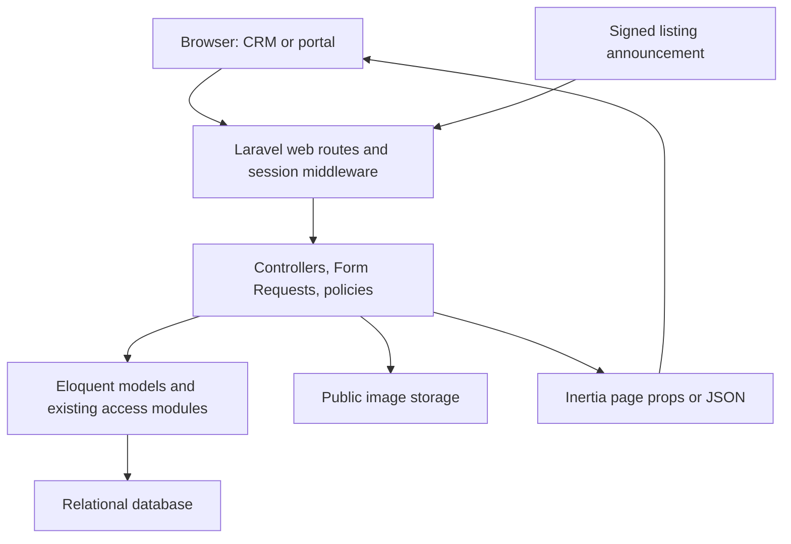
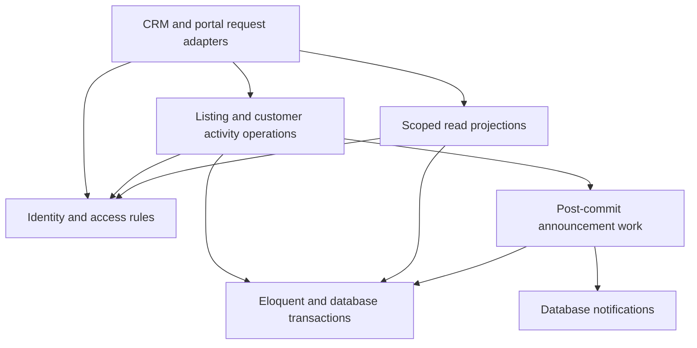
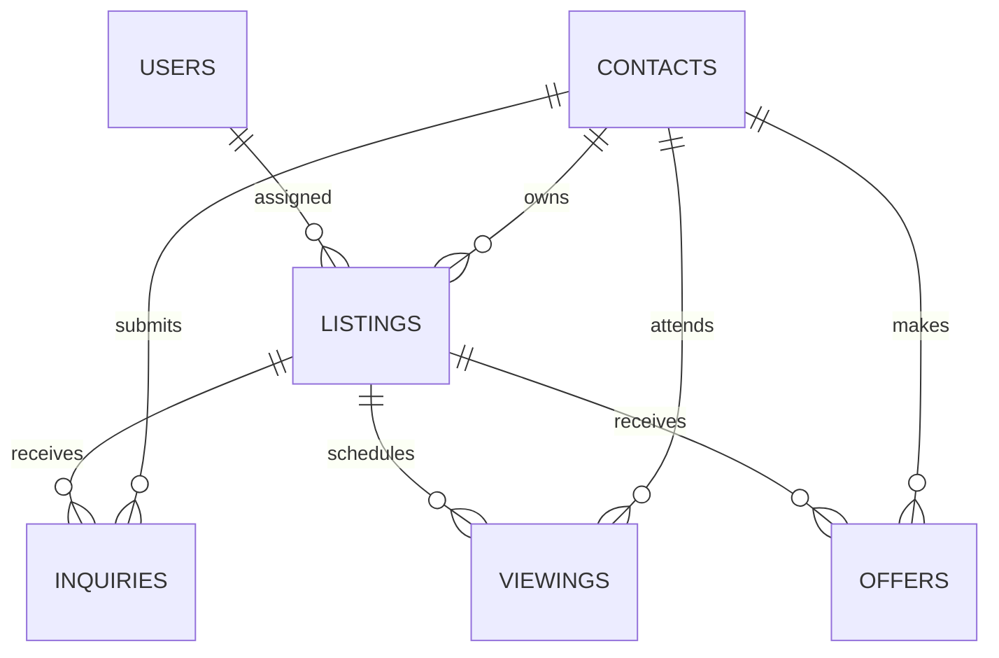

# CRM system architecture and design

Status: accepted foundation, 2026-10-22. Phase 1 access and trusted identity implementation is delivered locally on 2026-10-23. Phase 2 lifecycle and atomic public intake are delivered locally on 2026-10-24. Media, announcement reliability, and design foundation work below remains planned. Production database selection and browser verification remain open. See [implementation results and remaining work](foundation-roadmap.md) and [original review validation](foundation-validation.md).

## 1. Scope and sources of truth

One agency operates listings and customer activity through an internal CRM. Customers browse published properties and manage their own portal activity. Preserve the current Laravel/Inertia deployment and deepen modules where business coordination currently leaks across callers.

| Concern | Current authority |
| --- | --- |
| Executable behavior and schema | `laravel/app`, `routes`, `database/migrations`, tests, lockfiles |
| Product terms | [CONTEXT.md](../CONTEXT.md) |
| Intended cross-cutting design | This document and [ADRs](adr/README.md) |
| Intended UI rules | [Design system](design-system.md) |
| Known gaps and implementation order | [Foundation roadmap](foundation-roadmap.md) |
| Historical references | May specs, `docs/stitch-ui-ux.md`, existing `design/*.png` |

The historical MVP excludes public intake and describes mandatory Redis and REST endpoints. The implemented product has public intake, Inertia web routes, and database-backed infrastructure by default. Those historical statements are superseded by this foundation. Do not rewrite running behavior from an old diagram.

Excluded for this iteration: tenancy, subscription billing, MLS/IDX, calendar sync, forecasting, native mobile clients, and a standalone REST backend. The current “Sell” navigation is not evidence of a completed seller workflow. User/org administration is also not complete merely because permissions exist.

## 2. Implemented baseline

- Laravel 13 with Fortify session authentication, Inertia React 3, React 19, TypeScript, Tailwind 4, Radix-based UI primitives, and Wayfinder. Locked baseline: Laravel 13.12.0 and Inertia Laravel 3.1.0.
- One application and relational database. SQLite is the local default; sessions, cache, and queue default to database drivers. Redis is optional.
- CRM resources: Listings, Contacts, Inquiries, Viewings, Offers, Tasks, Notes, dashboard. Existing controllers often serve both Inertia and JSON through content negotiation.
- Public routes: property browse/detail. Authenticated portal: saved listings/searches, inquiries, viewing requests, deal tracker, settings, notifications.
- Custom role/permission tables and policies use `OwnershipScope` for CRM queries, nested projections, parent access, and dashboard visibility. Resource permissions remain independent across nested records.
- Listing images use Laravel public storage. The listing-offered webhook verifies HMAC and timestamp, then writes database notifications synchronously.

## 3. Intended module ownership

These are logical modules inside the existing application, not new deployed processes or a mandatory class per table. Concrete class names and method interfaces should be chosen during the relevant implementation phase.

| Module | Owns | Existing anchors | Intended change |
| --- | --- | --- | --- |
| Identity and access | Staff eligibility, permissions, assignment visibility, portal identity | User, Fortify actions, policies, `OwnershipScope`, `BuyerPortalScope` | One consistent implementation of visibility; transactional identity provisioning |
| Listing operations | Publication, assignment, lifecycle, media coordination | Listing controller/requests/model/enums | Explicit transitions, closure timestamp, media compensation |
| Customer activity | Inquiry intake, Viewing requests/confirmation, Offer decisions | Inquiry/Viewing/Offer controllers/requests | Coordinate related writes and lifecycle effects |
| Tasks and notes | Supported parent resolution and accessible activity | Task/Note controllers/requests/models | Reuse access rules for all supported parents |
| Portal presentation | Public projections and each customer's own activity | Public/Buyer controllers | Reuse publication and identity rules; expose minimal props |
| Listing announcements | Event receipts, recipient eligibility, delivery/retries | Webhook controller and notification | Durable idempotency and actual queued processing |
| Reporting | Permission-scoped dashboard projections | DashboardController | Reuse read rules and authoritative event dates |
| UI foundation | Tokens, shared primitives/patterns, shell conventions | CSS, UI modules, layouts, workflow-support | Remove page-specific visual rules from shared behavior |

Controllers adapt HTTP to a business operation and format its result. Form Requests validate input and authorize the attempted operation. Policies call the shared access rules. An operation that coordinates writes owns its transaction, invariant checks, and post-commit effects. Ordinary single-record CRUD can remain direct Eloquent. Avoid pass-through repositories whose deletion removes complexity without exposing hidden behavior.

Reuse `app/Actions/<Domain>/` for new coordinated operations and the current `app/Services` anchors for shared access behavior. Keep `Models`, `Policies`, `Http/Requests`, and controller folders. Do not create a parallel `Domain/Infrastructure/Application` tree. Database and storage remain Laravel implementations; a second adapter must justify a new abstract seam.

## 4. Authorization and visibility contract

Authentication, email verification, CRM entry, permission, and record visibility are separate checks. Admin's explicit global bypass remains. For non-Admin staff, a resource permission never overrides assignment scope.

| Actor | Listings | Customer activity / Contacts | Tasks and Notes | Portal |
| --- | --- | --- | --- | --- |
| Guest | Published projection only | No CRM records | None | Browse/property detail |
| Verified portal User | Published projection | Only own linked Contact activity; no internal notes | None | Own saves, searches, settings, notifications |
| Agent / restricted staff | Assigned Listings + relevant permission | Accessible Listing activity + relevant permission; linked Contacts only | Permission + accessible parent | No additional customer rights from staff role |
| Admin | All non-deleted CRM records | All non-deleted CRM records | All non-deleted CRM records | Do not impersonate a customer's linked identity implicitly |

Enforce these rules for index results, detail, form options, nested relations, dashboard counts/activity, JSON responses, and submitted identifiers. Dashboard sections are independently gated by the relevant read permission. A restricted role with only `task.read` must not receive listings or offers through dashboard props.

An accessible Contact can be shared between Agents. Returning that Contact must filter each related Listing/Inquiry/Viewing/Offer to the requesting staff member's permissions and assignment. Neither the UI nor the initial Contact policy can perform that filtering after serialization.

Standalone Contact creation and deletion are Admin-managed. Agents with `contact.create` may create a new owner or buyer inside authorized Listing or Inquiry intake, which links the Contact atomically. Existing unrelated Contacts cannot be searched or attached merely by knowing an ID. A shared Contact's global identity changes are Admin-managed. An Agent may update a Contact used exclusively by their assigned Listings, subject to `contact.update`. The intake forms support both existing accessible Contacts and new Contacts.

For reassignment or reparenting, authorize the existing record and the destination. Only Admin reassigns a Listing to a different staff member. The destination must be eligible staff, not any row in `users`. Task/Note supported parents remain Listing, Inquiry, Offer, and Contact; the same parent resolver must govern options, validation, lists, detail, and dashboard. Deny unknown/deleted parents. Assignment or authorship alone does not grant access.

Public publication means non-deleted Active/Under Offer. It must be reused for browse/detail, bookmarks, inquiry/viewing intake, and notification links. Bookmarks never authorize an unpublished property. Portal writes derive identity from the session; notifications and saved searches are scoped by User ID, and customer activity by the established linked Contact.

For email verification, implement the verification contract before trusting `verified` middleware. Registration creates a new User/Contact association atomically; it does not claim an existing CRM Contact solely by matching email. Existing-contact linking is a separately verified, Admin-mediated operation with ambiguity/conflict handling. Portal GET reads must not silently create or restore Contacts. Legacy missing associations need an explicit repair path.

## 5. Implemented lifecycle rules

The concrete `Actions/Lifecycle/ChangeRecord` operation owns the following transition table, permission rechecks, parent Listing serialization, state effects, and atomic `state_transitions` history. Staff HTTP adapters, including JSON, use this operation. `CreateListing` and `CreateInquiry` retain their transactional Contact intake responsibilities. New staff Viewings may begin Requested or Scheduled. New Inquiries, Offers, and Tasks begin New, Submitted, and Open respectively.

| Listing state | Allowed next state | Rule |
| --- | --- | --- |
| Draft | Active, Closed Lost | Activation requires validated property data, owner and eligible assigned staff |
| Active | Under Offer, Closed Lost | Under Offer may represent negotiation; accepting an Offer also sets it |
| Under Offer | Active, Closed, Closed Lost | Returning Active requires no Accepted Offer; successful closure requires one Accepted Offer and all competing Submitted Offers resolved |
| Closed | None | Historical metadata correction is separate from reopening |
| Closed Lost | None | Reopening is outside the current phase |

New Listings begin Draft. The additive lifecycle migration leaves every legacy `closed_at` null. Do not derive historical closure from `updated_at`; populate a legacy date only in a separately reviewed migration backed by an authoritative closure event. Successful closure writes `closed_at` exactly once in the same transaction and records the actor. “Closed this month” uses that timestamp in the agency timezone, not `updated_at`. `Closed Lost` is not a successful closure.

| Record | Allowed transitions |
| --- | --- |
| Inquiry | New → Contacted / Closed; Contacted → Qualified / Closed; Qualified → Converted / Closed; Converted and Closed terminal |
| Viewing | Requested → Scheduled / Cancelled; Scheduled → Completed / No Show / Cancelled; terminal after an outcome |
| Offer | Submitted → Accepted / Rejected / Withdrawn; Accepted → Withdrawn before Listing closure; Rejected/Withdrawn terminal |
| Task | Open → In Progress / Done; In Progress → Open / Done; Done → Open for an explicit reopen |

Accepting an Offer requires Active/Under Offer, an accessible buyer Contact, positive decimal amount, and at most one Accepted Offer per Listing. Serialize decisions on the parent Listing and enforce an engine-appropriate database constraint or equivalent guarded write. Withdrawal of the Accepted Offer returns an Under Offer Listing to Active. A Closed/Closed Lost Listing admits no new Inquiry, Viewing, or Offer. Terminal historical records can receive explicit Admin corrections with a reason, rather than using the “schedule new Viewing” guard for every edit.

Do not change title-cased enum storage values. New transition history must persist actor, entity, prior/new state, timestamp, and correction reason where required. A Note is not a substitute for a reliable transition record. `state_transitions` stores actor, entity type/ID, old/new state, UTC time, operation, and reason. Terminal metadata corrections require explicit `operation=correct`, Admin, and reason; they cannot rewind state or move related identities. Historical Viewing outcomes may have their timestamp corrected without the future-scheduling guard. Nonterminal Viewing outcomes can still be recorded after Listing closure, while new scheduling cannot. Task reopening requires `operation=reopen` and a reason. Identical unchanged retries do not add history.

## 6. Coordinated writes, retries, and errors

| Operation | Atomic database work | Side effects / retry rule |
| --- | --- | --- |
| Account provisioning | User + new Contact + unique association | Verification after commit; duplicate email/conflict handled without claiming an arbitrary Contact |
| Public Viewing request | Resolve identity, recheck publication, reuse/create Inquiry, create Requested Viewing | Preserve buy/rent intent; identical active requests cannot be duplicated under concurrency |
| Offer decision / closure | Recheck permission/state, serialize parent decisions, write affected states + transition history | Post-commit announcements only; double acceptance cannot succeed |
| Listing + media intake | Listing and media metadata | Stage uploads, clean staged files on failure, finalize consistently; filesystem is outside DB rollback |
| Listing announcement receipt | Unique event receipt and durable dispatch intent | Same event/payload retries return the previous acceptance; reused ID with different payload is rejected |

Implemented public intake is owned by `Actions/Viewings/RequestPublicViewing` and `Actions/Inquiries/CreatePublicInquiry`. Both recheck trusted linked identity and publication inside the transaction. Public Viewing requests use authenticated identity, Listing, and an offset-normalized UTC requested time, persisted at second precision, as the duplicate identity. Buy/rent intent is preserved; older callers omitting intent reuse the existing open Inquiry intent, otherwise default to buy. Preserve a useful retry identity even if delivery is retried; cancellation permits a deliberate new request. The additive migration uses partial unique indexes for one Accepted Offer per Listing, including soft-deleted Offers, and one non-deleted Requested/Scheduled Viewing per Listing, Contact, and normalized time. It preflights conflicting legacy rows without modifying them and fails safely on engines other than SQLite/PostgreSQL. Local SQLite tests exercise real competing processes with the application connection options; PostgreSQL support and production locking are not verified. Cancellation releases the active-time identity. Submitted/Accepted Offers must be resolved before deletion. Legacy soft-deleted Submitted Offers cause an actionable migration preflight failure and require reviewed restoration and resolution; no resolution is invented. Legacy deleted Accepted Offers remain evidence for uniqueness and closure counts. A transaction around `exists()` and `create()` alone is insufficient.

Webhook adapter duties remain raw-body HMAC verification and timestamp tolerance. Require a stable producer event ID; reject missing IDs rather than silently collapsing all future announcements for a Listing. Persist a receipt/dispatch record, process recipients in bounded chunks, and use a unique event/recipient delivery identity. Workers must handle interrupted fan-out and retry without duplicate visible notifications. Use actual queued work and post-commit dispatch; the current `Queueable` trait alone does not provide this.

Keep the existing route compatible through an explicit migration/version decision if producer expectations change. Tighten the broad `webhooks/*` CSRF exception to the intended route, and apply a route-specific rate limiter. Do not log signatures, secrets, or raw customer payloads. No broker or external event platform is needed for this phase.

| Failure | Intended response |
| --- | --- |
| Guest on protected screen | Authentication redirect; JSON callers receive appropriate unauthenticated status |
| Unauthorized action | 403; public unpublished property and another User's portal item return 404 |
| Invalid input | Field errors through Inertia; 422 JSON |
| Stale/invalid workflow transition | Form error or 409 JSON; no partial writes |
| Same idempotency key with different payload | 409; no new work |
| Accepted asynchronous announcement | 202 with receipt identity, not a synchronous delivery count |
| Infrastructure failure | Roll back, compensate files where needed, return a safe error with a traceable request ID |

## 7. Data and transport

| Relationship | Implemented representation |
| --- | --- |
| User ↔ Roles ↔ Permissions | Integer User IDs; UUID role/permission/pivot IDs; unique role keys and pivot pairs |
| Listing → assigned User / owner Contact | Integer `assigned_agent_id`; UUID `owner_contact_id` |
| Inquiry / Viewing / Offer → Listing + Contact | UUID references; Viewing also has integer `agent_id` |
| Task / Note → supported parent | UUID polymorphic ID + stored class-name type; integer assignee/author |
| User → portal Contact | Nullable unique UUID `contact_id`; one account association per Contact |
| Saved listing / search / notification → User | User-scoped portal data; UUID listing references where relevant |

This focused diagram omits RBAC, optional account links, polymorphic parents, media and bookmarks; the table and migrations supply those details. It does not assert that Contacts are isolated by agency tenancy.

Do not silently replace stored polymorphic class names with aliases: a future morph-map change needs a data migration. Soft deletes do not prove every related reference is valid; intake and access rules must reject deleted targets. Hard deletion is outside normal CRM operations.

Money remains decimal in DB and string-safe in write contracts. Standardize locale `en-PH`, currency `PHP`, display timezone `Asia/Manila`, and explicit UTC/offset timestamps. Viewing form values must convert between local display and offset-bearing transport. `area_sqft` stays square feet until an explicit unit migration.

Inertia props are public to the receiving browser: expose intentional read projections, not unrestricted eager-loaded models. Public and CRM projections differ. JSON responses must use the same authorized read/write behavior as Inertia; retain existing routes while stabilizing explicit shapes. Do not add a versioned REST backend without a real consumer. Page props may include computed capabilities for UX; they never replace server checks.

## 8. UI system and operations

Follow the [design system](design-system.md): one CSS token source, shared primitives/patterns, two purposeful shells. Keep domain types out of page utility modules. The React tree presents backend state; do not add a second global CRM entity store without evidence.

Local infrastructure remains SQLite plus database sessions/cache/queue. Production database selection is still a deployment decision. Offer/intake concurrency claims must be verified against the actual selected engine; in-memory SQLite tests cannot validate production locking semantics. Redis is optional after measured need.

Deploy one web application with built Vite assets and a queue worker when queued announcements are implemented. Share durable media storage across web/worker instances. Secure cookies, HTTPS, production debug off, real verification-mail delivery, database/media backup-and-restore, worker supervision, failed-job visibility, and secret provisioning are release requirements. Demo seed credentials are local-only; do not run the demo seeder in production.

Keep reads paginated (existing CRM page size: 15); bound options and notification reads. Add indexes after examining assignment + status + time queries with representative data. Measure query counts/latency before cache changes; permission-sensitive cache keys must include the actor and permission/assignment context. Record request IDs, failure outcomes, and queue backlog without personal payloads. No performance or capacity result has been measured in this review.

## 9. Verification gates

- Access: denied actions plus absence of forbidden fields/records in every projection, including restricted-role dashboard and shared Contacts.
- Identity: unverified portal writes denied; registration rollback; explicit linking conflicts; GET reads do not provision.
- Workflows: transition table, parent reassignment, competing Offer decisions, stable closure metrics, historical corrections.
- Reliability: Viewing rollback/retry, media cleanup, signed webhook replay/partial-fan-out recovery, recipient/event uniqueness on the selected database engine.
- UI: type/lint/format/build checks plus keyboard use, contrast, appearances, responsive forms/tables and loading/error/empty states.

Phase 1 access and identity tests cover the implemented rules listed in the [roadmap](foundation-roadmap.md). Phase 2 tests cover transition matrices, denied initial/terminal operations, rollback/history failures, retry model freshness, immutable closure metrics at Manila boundaries, and competing Offer/public Viewing processes on isolated file SQLite. Browser checks remain blocked by the unavailable preview server and the browser local-file URL policy. Media, announcement reliability, and broader UI gates remain future acceptance criteria. Continue in phase order.

## Technical references

Checked 2026-10-22. Project-specific decisions above are engineering judgments based on the repository, rather than requirements imposed by the frameworks.

- [Laravel authorization](https://laravel.com/docs/13.x/authorization) and [email verification](https://laravel.com/docs/13.x/verification).
- [Laravel database transactions](https://laravel.com/docs/13.x/database#database-transactions), [pessimistic locking](https://laravel.com/docs/13.x/queries#pessimistic-locking), and [queued notifications](https://laravel.com/docs/13.x/notifications#queueing-notifications).
- [Inertia 3 authorization](https://inertiajs.com/docs/v3/security/authorization) and [shared data](https://inertiajs.com/docs/v3/data-props/shared-data).
