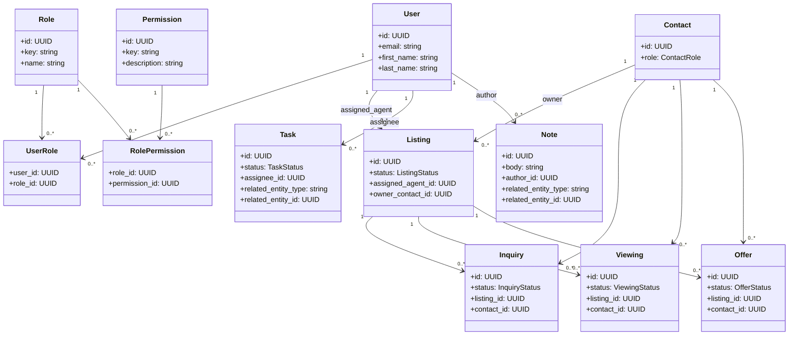
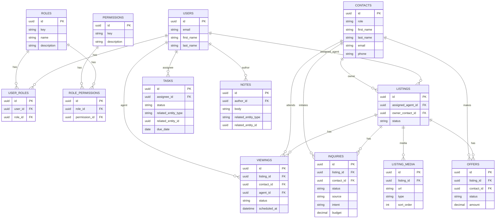

# Flexible RBAC + Ownership-Scoped Permissions - Design

> Historical spec (May 2026). Read the [current architecture foundation](../../architecture.md) and [access decision](../../adr/0002-access-and-identity.md). The implemented User primary key and its references are integers, while CRM/role/permission IDs are UUIDs. The diagrams below are conceptual references, not the authoritative migration schema.

## Context
We need a flexible RBAC model for the CRM MVP that distinguishes Admin and Agent roles and enforces ownership-scoped access for non-admins. This design should align with the listing-centric workflow in the CRM spec.

## Goals
- Support Admin and Agent roles with a flexible permissions system.
- Enforce ownership-scoped permissions for Agents.
- Keep the model extensible for future roles and permissions.

## Non-Goals
- Public/anonymous user access rules (handled as request context, not a stored user).
- Fine-grained field-level permissions.

## Assumptions
- A single workspace (no multi-tenant access yet).
- Listing ownership is represented by `listing.assigned_agent_id`.
- Related entities (inquiries, viewings, offers, tasks, notes) are scoped via listing ownership where applicable.

## RBAC Data Model
### Core Tables
- `users`
- `roles` (`key`, `name`, `description`)
- `permissions` (`key`, `description`)
- `user_roles` (`user_id`, `role_id`)
- `role_permissions` (`role_id`, `permission_id`)

### Roles
- `admin`
- `agent`

### Permission Keys
Use `resource.action` keys, for example:
- `listing.read`, `listing.create`, `listing.update`, `listing.delete`
- `inquiry.read`, `inquiry.create`, `inquiry.update`, `inquiry.delete`
- `viewing.*`, `offer.*`, `task.*`, `note.*`, `contact.*`, `user.*`

## Ownership-Scoped Permissions
Admin has global access. Agent access is scoped to records tied to listings they own.

### Scope Rules
- Listing: `listing.assigned_agent_id == user.id`
- Inquiry/Viewing/Offer: allowed if their `listing_id` belongs to a listing assigned to the agent.
- Task/Note: allowed if their related entity resolves to a listing assigned to the agent.
- Contact: allowed if the contact is linked to a listing assigned to the agent.

## Policy Evaluation Flow
1. If user has `admin` role, allow.
2. Otherwise, verify role has the permission key.
3. If granted, apply ownership checks as above.

## Class Diagram (Mermaid)

## ERD (Mermaid)

## Success Criteria
- Admin can access and manage all records.
- Agent can only access records tied to listings they own.
- Roles and permissions can be extended without schema changes.

## Testing Approach
- Unit tests for permission checks and ownership scope.
- Policy tests for each resource and action.
- Integration test for agent access boundaries.
